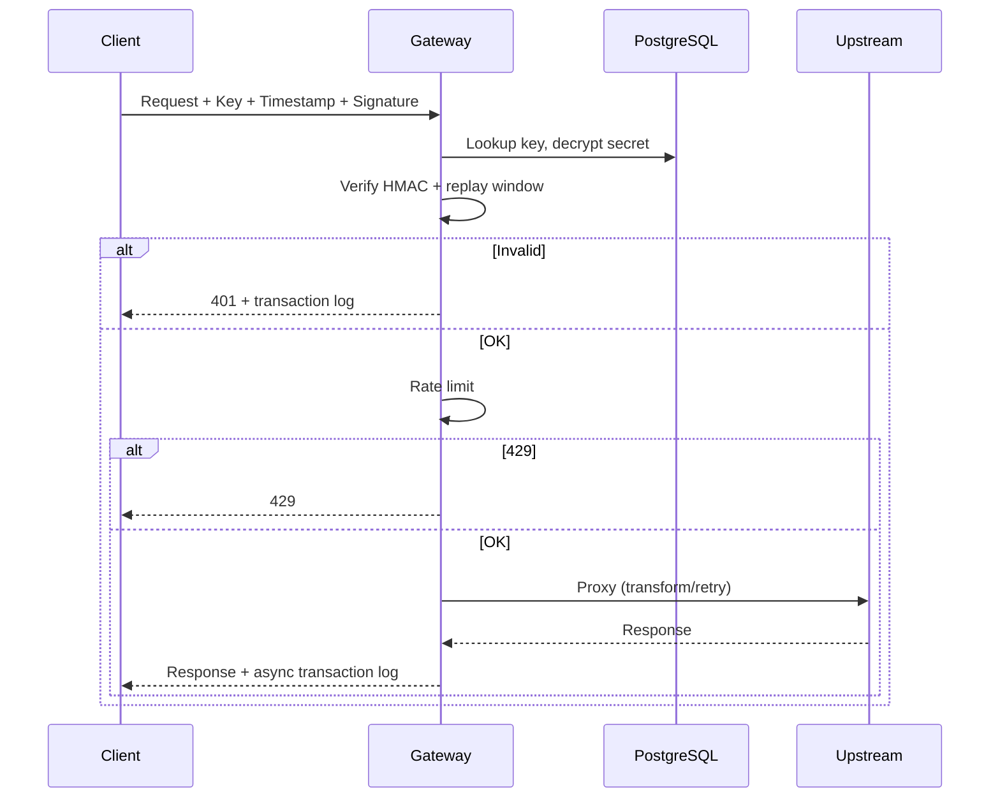

# Luồng HMAC — Data plane

**Không dùng JWT.** Client phải ký mỗi request.

## Header bắt buộc

| Header | Ý nghĩa |
|--------|---------|
| `X-API-Key` | Public key (`avaso_...`) |
| `X-Timestamp` | Unix giây (UTC) |
| `X-Signature` | HMAC-SHA256 hex |

## Payload ký

```text
{api_key}\n{timestamp}\n{METHOD}\n{path_with_query}\n{body}
```

`path_with_query` = path + `?query` nếu có.

## Luồng Gateway



## Replay

Cùng `(key, timestamp, signature)` lặp lại trong cửa sổ → từ chối.

Test: `python3 scripts/test_hmac_replay.py`

## Demo UI

Trang **Proxy Try** (`/proxy-try`) — admin tự sinh chữ ký, gọi thử gateway.

## So sánh JWT (HĐ hay hỏi)

| | JWT | HMAC (đồ án) |
|---|-----|----------------|
| Secret trên wire | Bearer token | Không gửi secret |
| Đổi nội dung request | Token vẫn “hợp lệ” nếu không bind body | Chữ ký bind method/path/body |
| Phù hợp | User session API | Machine-to-machine, API key |
