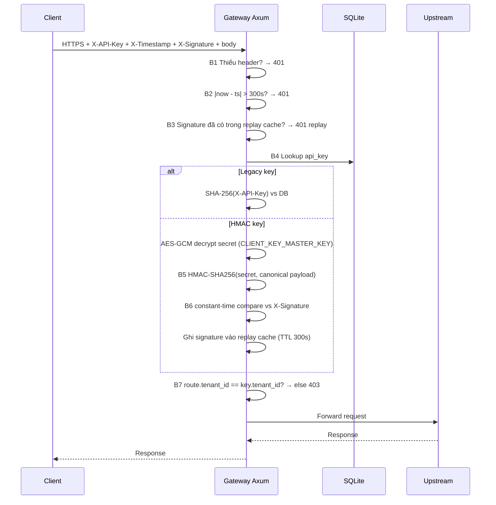

# Luồng HMAC tại Gateway (giải trình hội đồng)



**Canonical payload:**

```
{api_key}\n{timestamp}\n{METHOD}\n{path?query}\n{body}
```

`METHOD` = GET, POST, … (uppercase). `path?query` = raw URI path + query. Body empty → dòng cuối rỗng.
