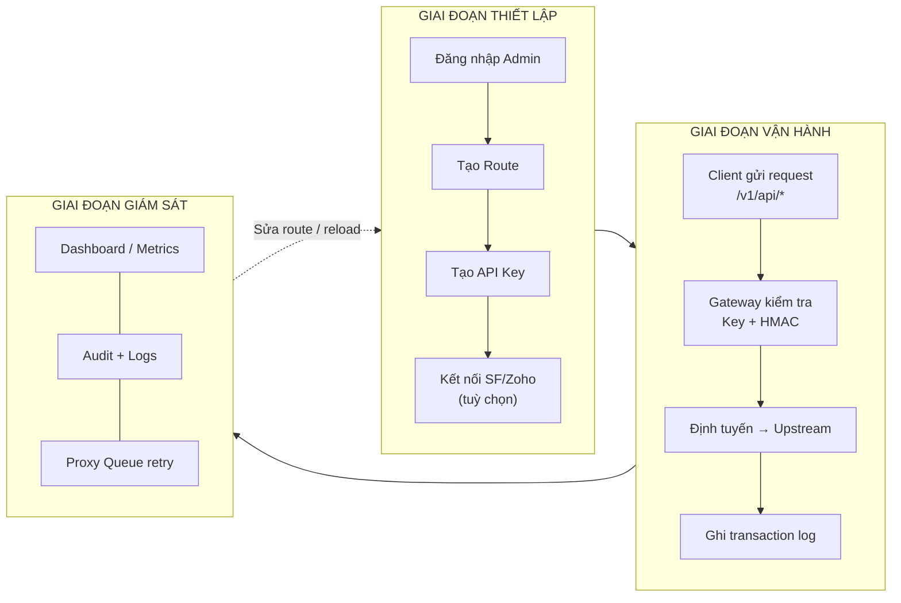
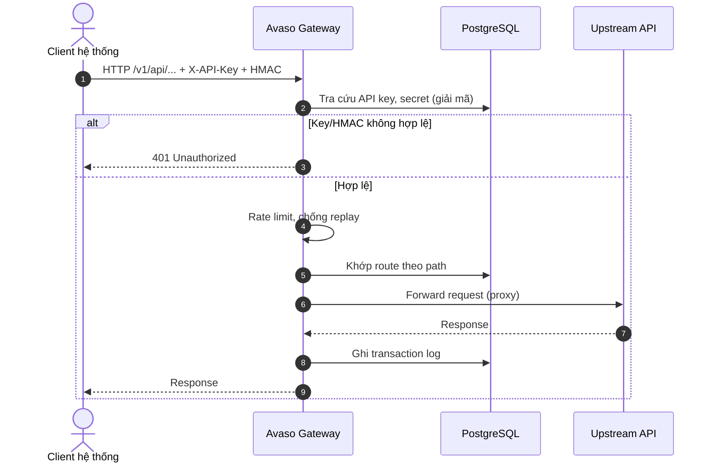
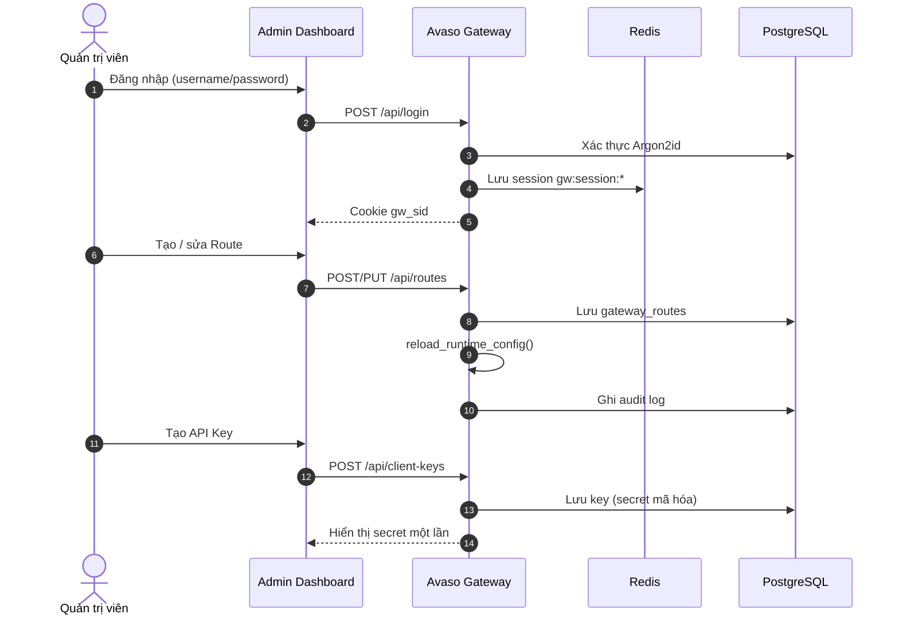

# Sơ đồ chức năng — Avaso API Gateway

Dùng cho **Hình 2.4** (Chương 2.3.2). Có thể copy Mermaid sang [mermaid.live](https://mermaid.live) → Export PNG/SVG → chèn Word.

---

## Hình 2.4 — Sơ đồ chức năng tổng quát (3 cấp)

```mermaid
flowchart TB
    subgraph HT["HỆ THỐNG AVASO API GATEWAY"]
        direction TB

        subgraph QP["A. QUẢN TRỊ & XÁC THỰC"]
            A1["A1. Đăng nhập / Đăng xuất"]
            A2["A2. Quản lý phiên (Redis session)"]
            A3["A3. Phân quyền RBAC<br/>(Admin / Operator / Viewer)"]
            A4["A4. Quản lý người dùng"]
            A5["A5. Cô lập workspace (tenant)"]
        end

        subgraph QR["B. CẤU HÌNH GATEWAY"]
            B1["B1. Quản lý tuyến định tuyến (Route)"]
            B2["B2. Quản lý Client API Key"]
            B3["B3. Mã hóa RSA envelope (WSO2-style)"]
            B4["B4. Cài đặt runtime<br/>(rate limit, metrics, DLQ)"]
            B5["B5. Nạp lại cấu hình nóng<br/>(reload-config)"]
        end

        subgraph QD["C. DATA PLANE — PHỤC VỤ CLIENT"]
            C1["C1. Xác thực X-API-Key"]
            C2["C2. Xác thực HMAC-SHA256"]
            C3["C3. Chống replay signature"]
            C4["C4. Rate limiting"]
            C5["C5. Định tuyến & reverse proxy"]
            C6["C6. Transform header / Retry"]
            C7["C7. Hàng đợi lỗi (Proxy Queue)"]
        end

        subgraph QT["D. TÍCH HỢP & BÁO CÁO"]
            D1["D1. Kết nối OAuth Salesforce"]
            D2["D2. Kết nối OAuth Zoho Projects"]
            D3["D3. Đồng bộ snapshot dữ liệu"]
            D4["D4. Dashboard KPI & biểu đồ"]
            D5["D5. Proxy data-plane SF/Zoho"]
        end

        subgraph QG["E. GIÁM SÁT & VẬN HÀNH"]
            E1["E1. Health check (DB + Redis)"]
            E2["E2. Metrics runtime"]
            E3["E3. Nhật ký giao dịch (transaction log)"]
            E4["E4. Nhật ký kiểm toán (audit log)"]
            E5["E5. Thử gọi Proxy / Tài liệu API"]
        end
    end

    ND1["Người quản trị<br/>(Admin / Operator / Viewer)"] --> QP
    ND1 --> QR
    ND1 --> QT
    ND1 --> QG

    ND2["Client hệ thống<br/>(ứng dụng bên ngoài)"] --> QD

    US["Upstream / CRM<br/>(HTTP API, Salesforce, Zoho)"] <-- QD
    US <-- QT
```

**Chú thích Hình 2.4:** Sơ đồ mô tả 18 nhóm chức năng chính của hệ thống, chia thành 5 module: Quản trị & xác thực (A), Cấu hình gateway (B), Data plane (C), Tích hợp & báo cáo (D), Giám sát & vận hành (E).

---

## Hình 2.5 — Sơ đồ chức năng chi tiết (ma trận FR)

| Mã | Chức năng | Module | Minh chứng trong sản phẩm |
|----|-----------|--------|---------------------------|
| F-01 | Đăng nhập admin, session cookie | A | `/login`, `POST /api/login` |
| F-02 | RBAC 3 role + tenant isolation | A | `admin_auth.rs`, `NavAccessGuard` |
| F-03 | CRUD Route | B | Trang **Quản lý Route** |
| F-04 | CRUD Client API Key + HMAC | B | Trang **Bảo mật & Auth** |
| F-05 | RSA envelope tạo key | B | `gateway_rsa.rs` |
| F-06 | Settings + hot reload | B | **Cài đặt hệ thống**, `POST /api/reload-config` |
| F-07 | Proxy + auth data-plane | C | `/v1/api/*`, `verify_client_auth` |
| F-08 | Dashboard tổng quan | E/D | Trang **Tổng quan** |
| F-09 | Audit log | E | Tab audit trong **Log vận hành** |
| F-10 | Transaction log | E | Tab traffic trong **Log vận hành** |
| F-11 | Rate limit token bucket | C | `config.yaml`, settings |
| F-12 | Retry, transform, DLQ queue | C | Route policy, **Proxy Queue** |
| F-13 | Connector Salesforce | D | Trang **Tích hợp** |
| F-14 | Connector Zoho Projects | D | Trang **Tích hợp** |
| F-15 | Báo cáo / snapshot KPI | D | Overview chart, sync |
| F-16 | Health & metrics | E | `GET /health`, `GET /metrics` |
| F-17 | Thử proxy / API docs | E | **Thử gọi Proxy**, **Tài liệu API** |
| F-18 | Quản lý Users | A | Trang **Quản lý Users** |
| F-19 | Hồ sơ cá nhân (đổi user/pass) | A | **Tài khoản của tôi**, `PUT /api/me` |

---

## Hình 2.6 — Sơ đồ quy trình nghiệp vụ tổng quát

*(Bổ sung cho mục 2.3.1 — luồng từ thiết lập đến vận hành)*



---

## Hình 2.7 — Quy trình nghiệp vụ: Client gọi API qua Gateway



---

## Hình 2.8 — Quy trình nghiệp vụ: Admin quản trị



---

## Hình 2.5 — Sơ đồ use case tổng quát (draw.io)

File: `docs/diagrams/Hinh_2_5_So_do_use_case_tong_quat.drawio`

**Actor (bên ngoài system boundary):**

| Actor | Vai trò |
|-------|---------|
| Quản trị viên (Admin) | Toàn quyền 5 khối chức năng |
| Nhân viên vận hành (Operator) | Route/key/log/queue; không Users/Settings/Tích hợp |
| Nhân viên giám sát (Viewer) | Chỉ xem route + overview; không key/log/queue/tích hợp |
| Client hệ thống | Chỉ tương tác **Data Plane** |
| Hệ thống ngoài (SF/Zoho) | Actor phụ — OAuth callback |

**5 Use case (trong boundary):** Quản trị & xác thực · Cấu hình Gateway · Data Plane · Tích hợp & báo cáo · Giám sát & vận hành

---

## Cách chèn vào Word (Tài liệu LVTN.docx)

1. Mở https://mermaid.live
2. Paste một trong các khối `mermaid` ở trên
3. **Actions → Export PNG/SVG** (độ phân giải 2x cho in ấn)
4. Word → **Hình 2.4** → Insert Picture → căn giữa
5. Caption: *Hình 2.4. Sơ đồ chức năng tổng quát hệ thống Avaso API Gateway*

**Gợi ý chọn hình cho luận văn:**
- **Bắt buộc:** Hình 2.4 (sơ đồ chức năng 3 cấp)
- **Nên có:** Hình 2.6 hoặc 2.7 (quy trình nghiệp vụ — HĐ hay hỏi)
- **Phụ lục:** Bảng F-01…F-18 (Hình 2.5 dạng bảng, không cần vẽ)
