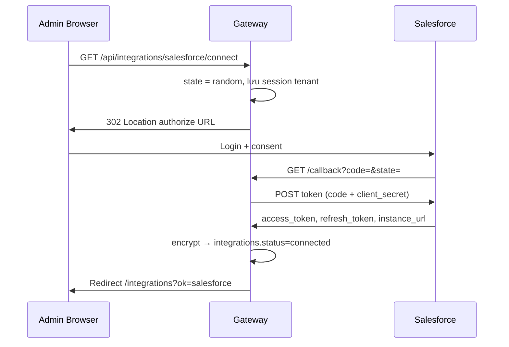

# Tích hợp Salesforce, Zoho Projects & Dashboard báo cáo

**Phiên bản:** 1.0  
**Ngày:** 2026-05-21  
**Liên kết:** Bổ sung cho [Document.docx](./Document.docx) (SRS gateway MVP) và [MO_HINH_BAO_MAT.md](./MO_HINH_BAO_MAT.md).

---

## 1. Mục đích và phạm vi

### 1.1 Mục đích

Mô tả yêu cầu **mở rộng** Avaso Gateway từ lát cắt API Gateway sang **lớp tích hợp (integration layer)** với:

| Hệ thống | Vai trò trong demo / đồ án |
|----------|----------------------------|
| **Salesforce** | CRM — Opportunities, Accounts, API limits |
| **Zoho Projects** | PM — Projects, Tasks, Milestones |
| **Dashboard báo cáo** | UI tổng hợp trạng thái kết nối + số liệu đã đồng bộ / proxy |

Tài liệu dùng để: thiết kế DB, API admin, UI (`ExampleWeb`), kiểm thử OAuth, ma trận truy vết FR mới.

### 1.2 Phạm vi

| Trong phạm vi | Ngoài phạm vi (phase sau) |
|---------------|---------------------------|
| OAuth 2.0 server-side (gateway), token mã hóa at rest | ETL batch hàng đêm, data warehouse |
| 1 tenant demo + RBAC admin | Multi-org Salesforce, Zoho region phức tạp |
| Đồng bộ / proxy **read** một số entity (snapshot) | Ghi hai chiều CRM/PM đầy đủ |
| Dashboard: trạng thái integration + KPI + bảng snapshot | BI Grafana enterprise, ML forecast |
| SQLite bảng `integrations`, `integration_snapshots` | Postgres cluster |

### 1.3 Định vị trong kiến trúc (mở rộng Document.docx)

```
                    ┌─────────────────────────────────────┐
                    │     Admin Dashboard (React)        │
                    │  Tổng quan │ Tích hợp │ Báo cáo    │
                    └──────────────┬──────────────────────┘
                                   │ Admin API (session + RBAC)
                    ┌──────────────▼──────────────────────┐
                    │         Avaso Gateway (Rust)         │
                    │  ┌─────────────┐  ┌────────────────┐ │
                    │  │ Data plane  │  │ Integration    │ │
                    │  │ proxy+HMAC  │  │ connector svc  │ │
                    │  └──────┬──────┘  └───────┬────────┘ │
                    └─────────┼──────────────────┼─────────┘
                              │                  │
                         Upstream HTTP    Salesforce / Zoho APIs
```

**Nguyên tắc:** Client bên ngoài vẫn dùng **API key + HMAC** (data plane). Token Salesforce/Zoho **không** xuất ra frontend; chỉ admin OAuth qua gateway.

---

## 2. Feature mới (bổ sung Document.docx)

| ID | Tên | Mục tiêu | Ưu tiên |
|----|-----|----------|---------|
| **F‑13** | Connector Salesforce | OAuth + lưu token + gọi thử SF REST | Must (spike ngày 4) |
| **F‑14** | Connector Zoho Projects | OAuth + đọc projects/tasks | Should (tuần 2) |
| **F‑15** | Dashboard báo cáo tích hợp | KPI + bảng snapshot theo provider | Must (sau khi có ≥1 connector connected) |

---

## 3. Mô hình dữ liệu

### 3.1 Bảng `integrations`

| Cột | Kiểu | Mô tả |
|-----|------|--------|
| `id` | INTEGER PK | |
| `tenant_id` | INTEGER FK | Cách ly theo tenant ([MO_HINH_BAO_MAT.md](./MO_HINH_BAO_MAT.md)) |
| `provider` | TEXT | `salesforce` \| `zoho_projects` |
| `status` | TEXT | `disconnected` \| `pending` \| `connected` \| `error` |
| `config_encrypted` | BLOB/TEXT | JSON `{access_token, refresh_token, instance_url, expires_at, ...}` — AES-256-GCM |
| `last_sync_at` | TEXT ISO8601 | Lần sync/report gần nhất |
| `last_error` | TEXT nullable | Message lỗi API gần nhất |
| `updated_at` | TEXT | |

**Ràng buộc:** `UNIQUE(tenant_id, provider)` — mỗi tenant tối đa một kết nối SF và một Zoho.

### 3.2 Bảng `integration_snapshots` (phục vụ báo cáo)

Lưu **bản chụp** JSON đã chuẩn hóa (không thay thế hệ CRM/PM).

| Cột | Kiểu | Mô tả |
|-----|------|--------|
| `id` | INTEGER PK | |
| `tenant_id` | INTEGER | |
| `provider` | TEXT | |
| `entity_type` | TEXT | vd `opportunity`, `account`, `project`, `task` |
| `payload_json` | TEXT | Mảng object đã map field |
| `record_count` | INTEGER | Số bản ghi trong payload |
| `fetched_at` | TEXT | Thời điểm pull từ API |

**Retention demo:** giữ 30 snapshot gần nhất / `(tenant, provider, entity_type)` hoặc xóa cũ hơn 7 ngày.

### 3.3 Env bắt buộc

| Biến | Mô tả |
|------|--------|
| `INTEGRATION_MASTER_KEY` | 32 byte base64 — mã hóa `config_encrypted` |
| `SF_CLIENT_ID` / `SF_CLIENT_SECRET` | Connected App Salesforce |
| `SF_REDIRECT_URI` | `https://thientinh.io.vn/api/integrations/salesforce/callback` |
| `ZOHO_CLIENT_ID` / `ZOHO_CLIENT_SECRET` | Zoho API Console |
| `ZOHO_REDIRECT_URI` | `https://thientinh.io.vn/api/integrations/zoho/callback` |
| `ZOHO_ACCOUNTS_URL` | `https://accounts.zoho.com` (hoặc `.com.cn` / EU nếu tenant Zoho khác region) |

---

## 4. Salesforce — yêu cầu chi tiết

### 4.1 Chuẩn bị Connected App

1. Setup → App Manager → New Connected App.
2. Enable OAuth, callback URL = `SF_REDIRECT_URI`.
3. Scopes tối thiểu demo:
   - `api` — REST API
   - `refresh_token`, `offline_access` — làm mới token
4. IP Relaxation: Relax IP restrictions (sandbox) hoặc whitelist IP Droplet production.

**Tài liệu tham khảo:** [Salesforce OAuth 2.0 Web Server Flow](https://help.salesforce.com/s/articleView?id=sf.remoteaccess_oauth_web_server_flow.htm).

### 4.2 Luồng OAuth (admin)



**Bảo mật:**

- `state` chống CSRF; hết hạn 10 phút.
- Chỉ role `admin` được `connect` / `disconnect`.
- Audit log: `integration.connect`, `integration.disconnect`, `integration.sync`.

### 4.3 API admin (gateway)

| Method | Path | Role | Mô tả |
|--------|------|------|--------|
| GET | `/api/integrations` | admin, operator (read) | List `{provider, status, last_sync_at, last_error}` |
| GET | `/api/integrations/salesforce/connect` | admin | Redirect OAuth |
| GET | `/api/integrations/salesforce/callback` | public (state) | Đổi code, lưu token |
| POST | `/api/integrations/salesforce/disconnect` | admin | Xóa token, status disconnected |
| POST | `/api/integrations/salesforce/sync` | admin | Pull snapshot (xem 4.4) |
| GET | `/api/integrations/salesforce/test` | admin | Gọi `GET /services/data/vXX.0/limits` |

### 4.4 Đồng bộ snapshot (báo cáo)

**Lần sync** (manual hoặc cron sau):

| Entity | Salesforce API | Field map (dashboard) |
|--------|----------------|------------------------|
| Opportunities | `GET .../query?q=SELECT+Id,Name,StageName,Amount,CloseDate+FROM+Opportunity+LIMIT+200` | `id`, `name`, `stage`, `amount`, `close_date` |
| Accounts | `SELECT Id,Name,Industry FROM Account LIMIT 200` | `id`, `name`, `industry` |

Lưu vào `integration_snapshots`. Cập nhật `integrations.last_sync_at`.

### 4.5 Proxy route (tuỳ chọn tuần 2)

Route data-plane ví dụ:

- Path: `/v1/sf/*`
- Upstream: `{instance_url}/services/data/v59.0/...`
- Middleware: inject `Authorization: Bearer {access_token}` từ decrypt (theo tenant của key).

---

## 5. Zoho Projects — yêu cầu chi tiết

### 5.1 Chuẩn bị Zoho API Console

1. [api-console.zoho.com](https://api-console.zoho.com) → Add Client → Server-based Applications.
2. Redirect URI = `ZOHO_REDIRECT_URI`.
3. Scope (Projects):

   ```
   ZohoProjects.portals.READ
   ZohoProjects.projects.READ
   ZohoProjects.tasks.READ
   ```

4. Lưu **Client ID**, **Client Secret**; chọn đúng **Data Center** (`.com`, `.eu`, `.in`…) → khớp `ZOHO_ACCOUNTS_URL`.

### 5.2 Luồng OAuth

Tương tự Salesforce; provider = `zoho_projects`.

Token response Zoho gồm `access_token`, `refresh_token`, `api_domain` (dùng cho Projects REST base).

### 5.3 API admin

| Method | Path | Role |
|--------|------|------|
| GET | `/api/integrations/zoho/connect` | admin |
| GET | `/api/integrations/zoho/callback` | public + state |
| POST | `/api/integrations/zoho/disconnect` | admin |
| POST | `/api/integrations/zoho/sync` | admin |
| GET | `/api/integrations/zoho/test` | admin — `GET /restapi/portal/` hoặc list portals |

### 5.4 Đồng bộ snapshot

| Entity | Zoho API (v3) | Field map |
|--------|---------------|-----------|
| Projects | `/restapi/portal/{portal_id}/projects/` | `id`, `name`, `status`, `owner` |
| Tasks | `.../projects/{project_id}/tasks/` | `id`, `name`, `status`, `due_date`, `project_id` |

**Lưu ý:** `portal_id` lấy từ bước test/list portals; lưu trong `config_encrypted` sau OAuth.

### 5.5 UI trạng thái “Sắp có”

Trước khi implement OAuth Zoho: card Zoho trên `/integrations` hiển thị badge **Sắp có**, nút Connect disabled — đã nêu trong [KE_HOACH_4_NGAY.md](./KE_HOACH_4_NGAY.md) ngày 4.

---

## 6. Dashboard báo cáo (UI + API)

### 6.1 Mục tiêu UX

Thay số **mock** trên trang Tổng quan (`Overview.tsx` — Total Requests 12,547…) bằng dữ liệu thật từ:

- Gateway: routes, health (đã có).
- Integrations: trạng thái SF/Zoho + snapshot counts.

### 6.2 Cấu trúc menu (ExampleWeb)

| Route | Label | Role |
|-------|-------|------|
| `/` | Tổng quan | all (guest: giới hạn) |
| `/integrations` | **Tích hợp** | admin connect; operator xem |
| `/reports` | **Báo cáo** | admin, operator, viewer (read-only) |

### 6.3 Trang `/integrations`

**Layout:** 2 card (Salesforce, Zoho Projects).

Mỗi card:

- Trạng thái: `Chưa kết nối` / `Đã kết nối` / `Lỗi` (màu badge).
- `last_sync_at`, `last_error` (nếu có).
- Nút **Kết nối** (admin) → `window.location = connect URL`.
- Nút **Ngắt kết nối**, **Đồng bộ ngay**, **Kiểm tra API** (admin).
- Link tài liệu setup (mở `docs/TICH_HOP_VA_BAO_CAO.md` §4 / §5).

### 6.4 Trang `/reports` — báo cáo tổng hợp

#### 6.4.1 KPI hàng đầu (4 ô)

| KPI | Nguồn | Công thức demo |
|-----|--------|----------------|
| Tích hợp đang hoạt động | `integrations` | `count(status=connected)` / 2 |
| Bản ghi snapshot (24h) | `integration_snapshots` | `sum(record_count) WHERE fetched_at > now-24h` |
| Lần sync thành công (7 ngày) | audit hoặc counter | đếm `integration.sync` success |
| Lỗi tích hợp (7 ngày) | `integrations.last_error` + audit | đếm failed sync |

#### 6.4.2 Biểu đồ (Chart.js / recharts — đã có `chart.tsx`)

| Chart | Trục | Dữ liệu |
|-------|------|---------|
| Snapshot theo ngày | X: ngày, Y: số record | group `integration_snapshots` by `date(fetched_at)` |
| Phân bổ theo provider | Pie | SF vs Zoho `record_count` |
| Opportunities theo Stage | Bar | payload `opportunity` — group `stage` |
| Tasks theo Status | Bar | payload `task` — group `status` |

#### 6.4.3 Bảng chi tiết

- Tab **Salesforce:** Opportunities, Accounts (paginate client-side 50 dòng).
- Tab **Zoho:** Projects, Tasks.
- Export CSV (Could): nút tải snapshot mới nhất.

### 6.5 API báo cáo (gateway)

| Method | Path | Response |
|--------|------|----------|
| GET | `/api/reports/summary` | `{connected_count, snapshots_24h, sync_success_7d, errors_7d}` |
| GET | `/api/reports/snapshots?provider=&entity_type=&limit=` | List metadata + optional payload |
| GET | `/api/reports/charts/daily` | Series cho biểu đồ ngày |
| GET | `/api/reports/charts/by-provider` | Pie data |

Tất cả filter `tenant_id` từ session.

### 6.6 Cập nhật trang Tổng quan (`/`)

- Giữ 4 StatsCard hiện tại (Gateway, Routes, API key, Uptime).
- Thêm hàng 2 card: **Salesforce** / **Zoho** — status + `record_count` lần sync cuối.
- Quick Stats: thay mock bằng `GET /api/reports/summary` (hoặc ẩn nếu chưa login).

---

## 7. Yêu cầu chức năng (FR mới)

| ID | Mô tả | AC | Priority |
|----|--------|-----|----------|
| FR-I1 | Gateway khởi tạo OAuth SF với state CSRF | Redirect hợp lệ sandbox; state sai → 400 | Must |
| FR-I2 | Callback lưu token encrypted | `integrations` row connected; plain token không trong DB/log | Must |
| FR-I3 | Refresh token trước khi gọi API nếu gần hết hạn | Sync không fail vì expired access_token | Should |
| FR-I4 | Zoho OAuth tương tự SF | Portal list OK sau connect | Should |
| FR-I5 | Sync snapshot SF Opportunities | ≥1 row snapshot, `record_count` > 0 | Must |
| FR-I6 | Sync snapshot Zoho Tasks | Tương tự khi Zoho connected | Should |
| FR-I7 | Dashboard hiển thị trạng thái integration | UI khớp API `/api/integrations` | Must |
| FR-I8 | Trang báo cáo KPI + chart từ snapshot | Số liệu thay đổi sau sync | Must |
| FR-I9 | Viewer chỉ đọc báo cáo, không connect | POST connect → 403 | Must |
| FR-I10 | Audit mọi connect/disconnect/sync | Row trong `audit_logs` | Must |

---

## 8. Yêu cầu phi chức năng

| Hạng mục | Yêu cầu |
|----------|---------|
| Bảo mật | Token chỉ trong `config_encrypted`; log mask; HTTPS bắt buộc OAuth |
| Hiệu năng | Sync 200 records < 30s; UI báo cáo load summary < 500ms |
| Tin cậy | API SF/Zoho lỗi → `integrations.status=error`, `last_error` rõ ràng |
| Vận hành | Nút “Kiểm tra API” không ghi snapshot (chỉ health) |

---

## 9. Kế hoạch triển khai (gợi ý)

| Giai đoạn | Nội dung | Tham chiếu |
|-----------|----------|------------|
| **Ngày 4** | SF OAuth + test limits + UI connect | [KE_HOACH_4_NGAY.md](./KE_HOACH_4_NGAY.md) |
| **Tuần 2** | Zoho OAuth + sync tasks/projects | §5 |
| **Tuần 2–3** | Bảng snapshots + `/reports` + charts | §6 |
| **Tuần 3** | Proxy `/v1/sf/*` (tuỳ chọn) | §4.5 |

---

## 10. Kiểm thử nhanh

```bash
# Sau OAuth SF thành công
sqlite3 data/gateway.db "SELECT provider, status, length(config_encrypted) FROM integrations;"

# Sync (cần session admin cookie)
curl -sS -X POST http://127.0.0.1:3000/api/integrations/salesforce/sync \
  -b /tmp/gw_cookies.txt | python3 -m json.tool

# Summary báo cáo
curl -sS http://127.0.0.1:3000/api/reports/summary -b /tmp/gw_cookies.txt | python3 -m json.tool
```

---

## 11. Ma trận truy vết (Document.docx ↔ mở rộng)

| Document.docx | Mở rộng tài liệu này |
|---------------|----------------------|
| Business case CRM/Salesforce (§2.1) | F‑13, §4 |
| F‑08 Dashboard | F‑15, §6 — báo cáo tích hợp |
| Ngoài phạm vi OAuth client (§3.4) | OAuth **admin** connector — không đổi data-plane API key |
| F‑12 Optional | Không thay; integration là nhánh riêng |

---

## 12. Checklist bổ sung vào Document.docx (Word)

Khi cập nhật file Word, thêm vào mục lục:

- **4.13 Feature F‑13:** Connector Salesforce  
- **4.14 Feature F‑14:** Connector Zoho Projects  
- **4.15 Feature F‑15:** Dashboard báo cáo tích hợp  
- **5.x Nhóm I:** Integration & Reporting (FR-I1 … FR-I10)  
- **5.6 Danh mục Integration API** (bảng §4.3, §5.3, §6.5)  
- Cập nhật **3.3 Trong phạm vi:** thêm integration layer + báo cáo snapshot  
- Cập nhật **3.4 Ngoài phạm vi:** làm rõ “OAuth client data-plane” vẫn ngoài phạm vi; “OAuth admin connector” trong phạm vi mở rộng  

---

*Tài liệu kỹ thuật bảo mật token: [MO_HINH_BAO_MAT.md](./MO_HINH_BAO_MAT.md). Kế hoạch ngày: [KE_HOACH_4_NGAY.md](./KE_HOACH_4_NGAY.md).*
